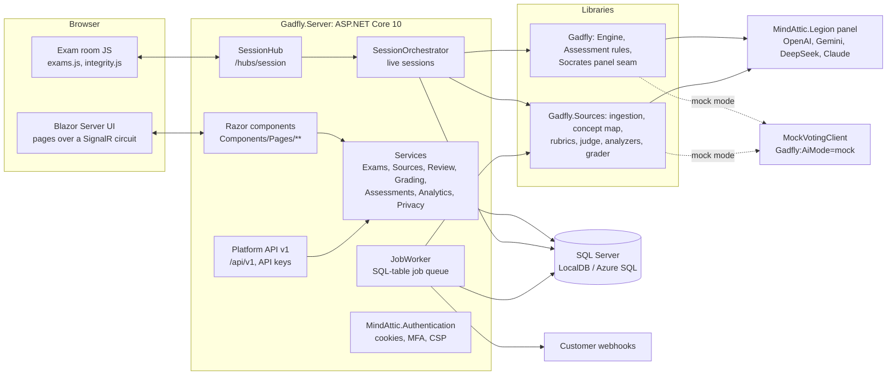
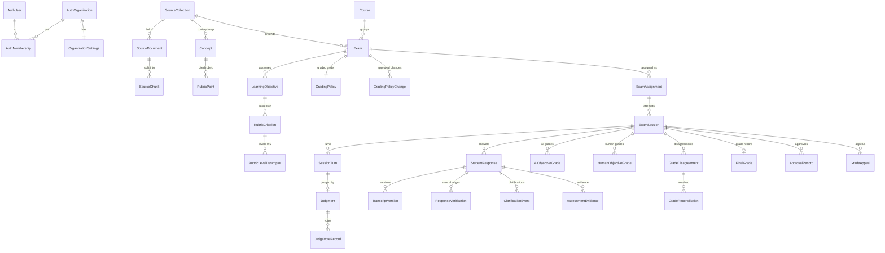
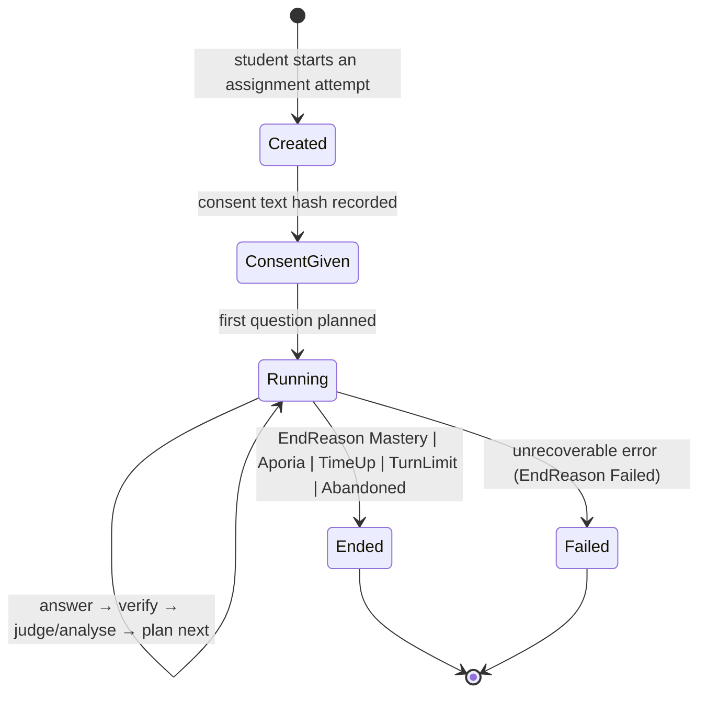
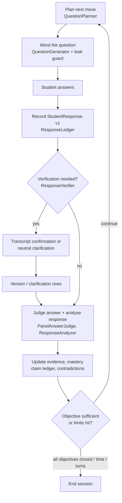
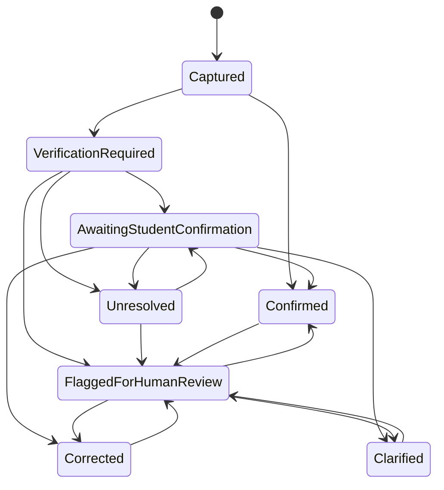
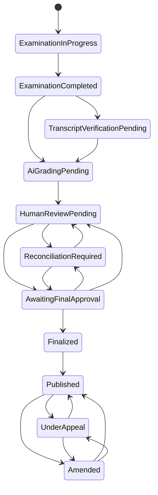

# Gadfly: system design

The design pack for [MASTER-PLAN.md](MASTER-PLAN.md) Part 19 Phase 1 (GAD-T80). It describes the system as the
code builds it, section by section, so every master-plan ticket can point at the part it implements. Where a
piece is still being built, it says so and names the ticket; the class names given for those are the ones in
`main` and the interfaces they expose.

Status words used below:

- **built**: on `main`.
- **in progress (GAD-Tnn)**: code exists under that ticket but is not finished; the
  description is its intended interface and may still change.
- **planned (GAD-Tnn)**: no code yet.

Contents:
[1 Requirements traceability](#1-requirements-traceability) ·
[2 Architecture](#2-architecture) ·
[3 AI components A-H](#3-ai-components-a-h) ·
[4 Database schema](#4-database-schema) ·
[5 Examination state machine](#5-examination-state-machine) ·
[6 Response verification state machine](#6-response-verification-state-machine) ·
[7 Grade status state machine](#7-grade-status-state-machine) ·
[8 Grading and approval workflow](#8-grading-and-approval-workflow) ·
[9 Role-permission matrix](#9-role-permission-matrix) ·
[10 Security architecture](#10-security-architecture) ·
[11 User flows](#11-user-flows) ·
[12 Deployment](#12-deployment)

The plan's conflict order governs every trade-off here: student safety, privacy and fairness; transcript and
evidence integrity; assessment validity; human grading accountability; functional correctness;
maintainability; performance; additional features. Deterministic rules (scores, thresholds, permissions,
state transitions) live in plain application code (`Gadfly/Assessment`), never in model output; model
output is schema-validated and treated as a recommendation.

---

## 1 Requirements traceability

| Master plan | What it requires | Where it lives | Tickets | Status |
|---|---|---|---|---|
| Part 1 | Product vision: Socratic examination, mandatory human grading | This document; [MASTER-PLAN-STATUS.md](MASTER-PLAN-STATUS.md) | GAD-T79 | built |
| Part 2.1-2.2 | Adaptive Socratic examination | `Gadfly/Engine` (`SocraticSession`, `QuestionPlanner`), `Gadfly.Sources/SourceExamRunner.cs` (`SourceExamEngine`) | GAD-T35, T44 | built |
| Part 2.3 | Strategies A-H | `MoveKind` (Gadfly/Engine/Moves.cs), see the table in section 3 | GAD-T90 | built |
| Part 2.4 | Adaptive question selection by information value | `QuestionPlanner`, `MoveProfiles` (Gadfly/Engine/Objectives.cs) | GAD-T89, T90 | built |
| Part 3 | Examination and Learning modes, assisted evidence kept apart | `AssessmentMode`, `Exam.AssessmentMode`, `GradingPolicy.AllowAssistedEvidence`, `MoveKind.Hint/GuidedExplanation`, `AssessmentEvidence.Assisted` | GAD-T93 | built |
| Part 4.1-4.2 | Accurate, versioned transcript | `StudentResponse` (immutable original), `TranscriptVersion`, `ResponseLedger` | GAD-T86 | built |
| Part 4.3-4.5 | Transcription and meaning verification, non-leading confirmation, confidence triggers | `ResponseVerifier` (Component C), `ClarificationEvent`. Spoken answers are taken as heard since GAD-T405 (owner decision): no read-back; unsure words are named to the panel and marked for the grader (GAD-T265); meaning clarification stays | GAD-T87, T88, T405 | built (read-back removed by owner decision) |
| Part 4.6 | Verification states | `VerificationState`, `VerificationMachine` | GAD-T86 | built |
| Part 4.7 | Correction integrity (transcription / meaning / substantive revision) | `CorrectionKind`, `CorrectionRules`, `ResponseKind.SubstantiveRevision` | GAD-T86, T88 | built |
| Part 5.1 | Multidimensional assessment | `AssessmentDimension`, `RubricCriterion.Dimension` | GAD-T81 | built |
| Part 5.2 | Evidence-based evaluation | `AssessmentEvidence`, `ResponseAnalyzer`, `ObjectiveAssessor` | GAD-T91 | built |
| Part 5.3 | Levels 0-5, level 0 = Insufficient Evidence | `MasteryLevel`, `MasteryLevels` | GAD-T81 | built |
| Part 5.4 | Confidence as categories, never invented percentages | `AiObjectiveGrade.Confidence`, `GradingConfidence` | GAD-T94 | built |
| Part 6 | Examination control and stopping, inconclusive outcomes | `QuestionPlanner`, `ObjectiveAssessor`, `ObjectiveStatus.Inconclusive`, `GradingPolicy.InconclusiveProcedure` | GAD-T89 | built |
| Part 7 | AI preliminary grading per objective and criterion | `AiObjectiveGrader`, `AiGradingJob`, `AiObjectiveGrade` | GAD-T94 | built |
| Part 8 | Mandatory, independent (blind) human grading | `HumanObjectiveGrade` (`WasBlind`, `SupersedesId`), `GradingService.SubmitHumanGradesAsync` | GAD-T95 | built |
| Part 9 | Weighted combined score | `GradingPolicyRules`, `CombinedScoring` | GAD-T82, T96 | built |
| Part 10 | Disagreement detection and reconciliation | `CombinedScoring.Band`, `GradeDisagreement`, `GradeReconciliation`, `GradingService.ReconcileAsync` | GAD-T96, T97 | built |
| Part 11 | Approval, statuses, appeals, amendments | `GradeStatus`, `GradeStatusMachine`, `FinalGrade`, `ApprovalRecord`, `GradeAppeal`, `GradingService` | GAD-T98 | built |
| Part 12.1 | Teacher assessment setup | `/assessments` pages, `AssessmentService` | GAD-T85 | built |
| Part 12.2 | Examination review | `/review` and `/grading` | GAD-T54, T95 | built |
| Part 12.3 | Educational analytics | `/analytics`, `Gadfly.Server/Analytics` | GAD-T102 | built |
| Part 13.2 | Text examination | `/exam/{id}` (`ExamRoom.razor`), `SessionHub`, `SessionOrchestrator`. Since GAD-T239 every exam is spoken; typed answers survive only as the staff-granted accommodation (`ExamRoom.Typed.cs`, GAD-T260) | GAD-T44, T239, T260 | built (as an accommodation) |
| Part 13.3 | Voice examination | `Gadfly.Server/Voice`, `VoiceRoom.razor`, MindAttic.SpeechRecognition and MindAttic.Avatar ([VOICE.md](VOICE.md)); mandatory with the camera | GAD-T53, T58, T239 | built |
| Part 18.3 | Integrations, billing | LTI 1.3 (`Gadfly.Server/Lti`, [lti-setup](guides/lti-setup.md)); plans and enforcement (`Platform/PlanCatalog.cs`, `PlanEnforcement`); optional card checkout (`Platform/CheckoutService.cs`, off without payment keys) | GAD-T309, T370, T371, T372, T380 | built |
| Reports | Assessment report, class summary and certificate as PDF; official transcripts with verification codes | `Grading/GradingReportPdf.cs`, `Transcripts/` | GAD-T295, T311 | built |
| Panel trust | Blind double marking, panel calibration (gating the AI weight), bias probes, self-preference check | `Gadfly.Server/Grading` (calibration, second marking, bias probes) | GAD-T427, T428, T429, T431, T432, T469 | built |
| Operations | Admin suite, help center and tours, system status and readiness, audit viewer | `Admin/`, `Help/`, `Tours/`, `/healthz/ready`; [OPERATIONS.md](OPERATIONS.md) | GAD-T292, T293, T296..T302, T356 | built |
| Part 14 | Course material ingestion, grounded questions, RAG | `SourceIngestor`, `ConceptMapBuilder`, `RubricBuilder`, `GroundingRetriever`, `SourceProcessingJob` | GAD-T33..T37 | built |
| Part 15.1-15.2 | Fairness, comparable difficulty | Fixed prompt sets per session (`PromptSetSha256`), deterministic planner, policy snapshot per grade | GAD-T89 | partly built |
| Part 15.3 | Scoring validation studies | Not a product feature: run with institutions after launch; analytics shows the agreement caveat | — | process |
| Part 15.4 | Academic integrity (signals are context, never proof) | `IntegrityEvent`, `IntegrityRecorder`, reviewer-only display (and the student's own result page, GAD-T450); `TextStyleAssessor` switched off (GAD-T412) | GAD-T59 | built |
| Part 16.1 | Institutional data protection | Tenant filter and write guard, retention, export/erase | GAD-T41, T42, T62 | built |
| Part 16.2 | Role-based access control | `PermissionMatrix` (section 9), `OrgRoles`, `GadflyPolicies` | GAD-T83 | built |
| Part 16.3 | Data security | Section 10 | GAD-T64 | built |
| Part 16.4 | Audit requirements | `AuditEvent` (append-only, enforced in `GadflyDbContext`) | GAD-T84 | built |
| Part 17 | Architecture, AI components, data entities | Sections 2-4 | GAD-T80 | built (this document) |
| Part 18.2 | MVP features 1-10 | Sections 3, 7, 8; the full product is the target (MASTER-PLAN-STATUS.md) | GAD-T81..T99 | built |
| Part 19 Phase 7 | Deployment | [DEPLOY.md](DEPLOY.md), section 12 | GAD-T63 | built; live in mock mode |
| Part 20 | Test scenarios A-J | `Gadfly.Tests` (NUnit), demo tour `Gadfly.Tour` | GAD-T101, T104, T105 | built |
| Part 22 | Mock mode, honest labelling | `MockVotingClient`, `SelectedPanel`, `Gadfly:AiMode` | GAD-T100 | built |

---

## 2 Architecture

One deployable web application plus libraries. No microservices: the plan asks for clear separation of
responsibilities, not network boundaries, and the AI components share one model panel.



| Layer | Project / folder | Responsibility |
|---|---|---|
| Deterministic rules | `Gadfly/Assessment` | Mastery levels, dimensions, modes, verification and grade-status machines, grading policy, combined scoring, permission matrix. No I/O, no LLM. |
| Examination engine | `Gadfly/Engine` | `SocraticSession` (the session record), `QuestionPlanner` (Component G), `MasteryModel` (Elo-style estimate), `ClaimLedger`/`ClaimAnalyzer` (contradictions), `QuestionGenerator` (wording + leak guard), `ExamPrompts`/`PromptSet` (versioned prompt sets, student text fenced in `<student_text>`). |
| Panel seam | `Gadfly/Socrates` | `ISocraticVotingClient` (`AskAsync`, `AskWithProfilesAsync`, `DecideAsync`, `FanOutAsync`) over MindAttic.Legion (`LegionVotingClient`), with `ProviderHealth`, `PanelUsage`; mock panel in `Socrates/Mock` (GAD-T100). |
| Source material and AI analysis | `Gadfly.Sources` | Ingestion and chunking, concept map, cited rubrics, hybrid retrieval, `SourceExamEngine` (the resumable step engine), `PanelAnswerJudge`, `TextStyleAssessor`; `ResponseAnalyzer`, `Verification/ResponseVerifier`, `Grading/AiObjectiveGrader`. |
| Web host | `Gadfly.Server` | Blazor Server UI, `SessionHub` (SignalR), Platform API, tenancy, jobs, privacy, review, grading, analytics. |
| CLI | `Gadfly.Cli` | Local runs of the engine against source folders (development and corpus work). |
| Tests and tour | `Gadfly.Tests`, `Gadfly.Tour` | NUnit suites (run only when the owner asks); the tour drives the whole workflow through the real server (GAD-T105). |

**Runtime pieces.**

- **Blazor Server.** Every page is interactive server rendering except the sign-in pages (static SSR so the
  auth library's antiforgery posts validate). Components open a DI scope per operation
  (`AdminDb.RunAsync`, `IServiceScopeFactory.CreateAsyncScopeFor`) and act as the circuit's pinned tenant
  (`TenantCircuitHandler`, `TenantSnapshot`), so a page never shares the circuit's `DbContext` across
  concurrent work and never falls back to an unfiltered system scope.
- **SignalR.** `SessionHub` carries the exam room: start (with consent hash), answer, correction and
  clarification replies, integrity signals. `SessionOrchestrator` (singleton) holds one live
  `SourceExamEngine` per session behind a per-session gate, binds it to the owning student, enforces the
  server time limit, and persists the session after every step (turns, judgments, claims, mastery,
  transcript JSON), so a session resumes exactly where it stopped.
- **Jobs.** `JobQueue` writes rows to the `Jobs` table; `JobWorker` (hosted service) leases and runs them
  through `IJobHandler`s: `SourceProcessingJob` (ingest, concept map, rubrics), `WebhookDeliveryJob`,
  `RetentionJob` (scheduled by `RetentionScheduler`), and `AiGradingJob` (GAD-T94, started by
  `GradingSweeper` when a session ends).
- **SQL Server.** EF Core 10, schema `gadfly` (application) and `auth` (MindAttic.Authentication). LocalDB in
  development, Azure SQL in production; migrations in `Gadfly.Server/Data/Migrations`.
- **Legion panel.** Every model call goes through `ISocraticVotingClient`. Structured work fans out to
  every active provider and Gadfly aggregates the schema-validated replies itself (majority, median,
  dissent), so one provider's error or bias does not decide an outcome. Usage is metered per call into
  `UsageEntry` rows (`UsageMeter`) against the organization's monthly cost quota.
- **Mock mode (GAD-T100).** `Gadfly:AiMode` = `live` | `mock` | `auto`. `SelectedPanel` decides
  once per process (auto: live when a startup probe finds a working provider, otherwise mock) and never
  flips mid-run. `MockVotingClient` answers every prompt deterministically from content-aware rules, marks
  every reviewer-visible rationale, and the host shows a MOCK banner on every screen. Mock AI grades are
  stored with `AiObjectiveGrade.IsMock = true` and are never shown or counted as genuine AI evaluations
  (analytics excludes them and says how many).

---

## 3 AI components A-H

Part 17.3's components, mapped to code. All share the Legion panel and the prompt-set machinery; each has a
narrow, testable interface.

| Component | Responsibility (Part 17.3) | Classes | Interface | Status |
|---|---|---|---|---|
| **A. Socratic Questioning Engine** | Generate and select adaptive questions | `QuestionGenerator`, `ExamPrompts`/`ExamPromptsV3`, `PromptSet`; selection in `QuestionPlanner` (with G) | `QuestionGenerator.GenerateAsync(QuestionRequest)` drafts across the panel, fuses one question, runs the leak guard (`LeakGuardResult`), redrafts once, then falls back to a safe template; fails closed | built; strategies and Learning Mode moves in progress (GAD-T90, T93) |
| **B. Student Response Analysis Engine** | Claims, misconceptions, uncertainties per answer | `ResponseAnalyzer` (Gadfly.Sources), `ResponseAnalysis`, `AnalysisClaim`, `AnalysisMisconception`, `ObjectiveEvidence`; contradictions in `ClaimAnalyzer`/`ClaimLedger` | `ResponseAnalyzer.AnalyzeAsync(AnalysisInput)`: every provider analyses; replies validated strictly against the schema; quotes must be verbatim spans of the answer; majority merge | contradictions built; analyzer in progress (GAD-T91) |
| **C. Transcript Verification Engine** | Accurate recording, clarification when needed | `ResponseVerifier`, `CorrectionRules` (Gadfly.Sources/Verification); `ResponseLedger` (server) | `ResponseVerifier.DecideAsync(VerificationInput)` decides from cheap deterministic triggers (incomplete sentence, explicit request, low speech confidence) then a panel vote (ambiguity, multiple interpretations, unrecognized terms), asks only when grading could be affected; `WordAsync` words the clarification, which passes a new-words check and the leak guard, else a template quoting the student | in progress (GAD-T87, T88) |
| **D. Evidence Collection Engine** | Organize verified responses into evidence | `ObjectiveEvidence`, `CollectedEvidence`, `AssessmentEvidence` rows, `ResponseLedger` | Evidence items point at a `StudentResponse` (and transcript version), carry stance, dimension, `Assisted` and `Contaminated` flags (`LeakFlag`, Scenario I) | schema built; collection in progress (GAD-T91, T92) |
| **E. Knowledge Evaluation Engine** | Evaluate understanding against objectives | `PanelAnswerJudge` (per answer, criteria, citations, per-voter verdicts, agreement, human-review flag), `MasteryModel`, `ObjectiveAssessor` (evidence sufficiency per objective) | `ObjectiveAssessor`: a level needs `SessionPolicy.MinCorroboratingAnswers` independent supporting answers and a tested ceiling; contaminated and assisted answers never count; otherwise Level 0 | judge built; objective evaluation in progress (GAD-T89) |
| **F. AI Grading Engine** | Preliminary rubric scores and explanations | `AiObjectiveGrader` (Gadfly.Sources/Grading), `AiGradingJob`, `AiObjectiveGrade` | Per objective and criterion: level 0-5 by (lower) median of voters, score = level/5 of the criterion's weighted share, Level-0 criteria left out and the rest renormalized, every level above 0 must cite evidence, citations and quotes verified, confidence as a category; result is preliminary and never published alone | in progress (GAD-T94) |
| **G. Examination Control Engine** | Next action, sufficient evidence, stopping | `QuestionPlanner`, `ObjectiveAssessor`, `SessionPolicy`, `MoveProfiles`, `EndReason` | Deterministic `PlanDecision` from the session, contradictions and remaining time: examines objectives one at a time, keeps competing level hypotheses, picks the move that best separates them; closes an objective when evidence is sufficient or limits are hit (then Inconclusive, Level 0) | in progress (GAD-T89) on the built planner |
| **H. Score Reconciliation Engine** | Compare AI and human scores, manage disagreements | `CombinedScoring` (bands, built), `GradeDisagreement`, `GradeReconciliation`, `GradingService.RequestSecondReviewAsync/ReconcileAsync`, `ReconciliationCauses` | Differences in percentage points of the objective's maximum; Standard / AdditionalReview / MandatoryReconciliation from the policy thresholds; reconciliation records cause and resolution and recalculates | rules built; workflow in progress (GAD-T97) |

Questioning strategies (Part 2.3) as planner moves (`MoveKind`):

| Strategy | Move |
|---|---|
| A Conceptual probing | `Probe` (plus `Elicit` to open, `Clarify` to tighten) |
| B Causal reasoning | `CausalReasoning` |
| C Counterexample testing | `Counterexample` |
| D Scenario variation | `ScenarioVariation` |
| E Knowledge transfer | `Apply` (and `Synthesize` across related concepts) |
| F Contradiction detection | `Contradiction` (from `ClaimLedger` contradictions) |
| G Assumption testing | `AssumptionTesting` |
| H Independent explanation | `IndependentExplanation` |
| Learning Mode only | `Hint`, `GuidedExplanation` (assistance; later answers are assisted evidence) |

**Model-output rules that hold everywhere.** Student text reaches prompts only inside `<student_text>`
fences declared as evidence, never instructions (GAD-T77); placeholders are filled in a single pass; answers
addressed to the grader always go to human review; every structured reply is parsed strictly and rejected
whole when malformed; quotes are kept only when they occur verbatim; no component invents a percentage of
certainty.

---

## 4 Database schema

All application tables are in schema `gadfly`; every tenant-owned entity implements `ITenantOwned`
(`OrganizationId`) and is covered by `GadflyDbContext`'s query filter and write guard. Accounts are in
schema `auth` (MindAttic.Authentication). Entities: `Gadfly.Server/Data/Entities.cs` (platform, materials,
sessions) and `AssessmentEntities.cs` (master-plan assessment model).



| Group | Entities | Notes |
|---|---|---|
| Organizations and people | `auth.AuthOrganizations`, `auth.AuthMemberships` (role per org) and `auth.AuthUsers` from MindAttic.Authentication (GAD-T156; `IOrganizationDirectory` is Gadfly's facade over the library's organization and invitation services), plus `OrganizationSettings` (retention days, cost quota) | Accounts are shared across organizations; membership and role are per organization. |
| Integration and operations | `ApiKey` (hash only), `Webhook` (secret protected), `WebhookDelivery`, `UsageEntry`, `Job` | |
| Course material | `SourceCollection` (optional `CourseId`), `SourceDocument`, `SourceChunk` (text, location, embedding), `Concept`, `ConceptRelation`, `ConceptCitation`, `RubricPoint` (Understanding / AcceptableVariant / Misconception, versioned) | Concepts become *suggested* objectives. |
| Assessment setup | `Course`, `Exam` (CourseId, Subject, Topic, `AssessmentMode`, policy JSON, prompt set id/version), `LearningObjective` (key, weight, max score, optional concept key), `RubricCriterion` (dimension, weight), `RubricLevelDescriptor` (0-5), `GradingPolicy` (weights, thresholds, blind flag, inconclusive procedure, assisted-evidence rule, `LockedAt`), `GradingPolicyChange` (before/after, reason, approver) | A policy is locked at publication; later changes need an approved change row. |
| Examination | `ExamAssignment` (window, attempts), `ExamSession` (state, end reason, consent hash, policy and prompt-set snapshot, transcript/ledger JSON, `RowVersion`), `SessionTurn` (move, question, answer, timings), `SessionClaim`, `Judgment`, `JudgeVoteRecord`, `ConceptMasteryRecord`, `IntegrityEvent`, `SessionReport`, `GradeDecision` (pre-plan single-grader decision) | |
| Responses and verification | `StudentResponse` (`OriginalText` immutable, enforced; `VerifiedText` used for grading; `Kind` Original / SubstantiveRevision with `RevisesResponseId`), `TranscriptVersion` (`CorrectionKind`, source), `ResponseVerification` (from/to/reason), `ClarificationEvent` (type, question, `NonLeadingChecked`, reply), `AssessmentEvidence` (stance, dimension, `Assisted`, `Contaminated`) | Originals, interpretations, corrections and final verified evidence are separate rows (Part 17.4). |
| Grading | `AiObjectiveGrade` (level, score, criteria/evidence/misconception/ambiguity/flag JSON, confidence category, `IsMock`), `HumanObjectiveGrade` (`WasBlind`, `SupersedesId`), `GradeDisagreement` (difference points, band), `GradeReconciliation` (cause, resolution, resolved scores), `FinalGrade` (status, percent, label, result and policy JSON, `RowVersion`), `ApprovalRecord` (Finalize / Publish / Amend / appeal / policy approval), `GradeAppeal` | History is kept: new rows supersede, nothing is overwritten. |
| Audit | `AuditEvent` (actor, role, action, entity, before/after JSON, reason, time) | Append-only: `GadflyDbContext` refuses updates and deletes. |

---

## 5 Examination state machine

Two levels: the session's lifecycle (persisted on `ExamSession.State`) and, inside a running session, the
control engine's per-objective status (`ObjectiveStatus`, GAD-T89).



`SessionState.Paused` exists in the schema but is not entered today: a disconnected student resumes the
`Running` session from its persisted state. The time limit is server-authoritative (`SessionStep.Remaining`);
the orchestrator ends the session with `TimeUp` when it runs out.

One step of a running session (the loop above):



Per objective (GAD-T89): `NotStarted → Open → Sufficient` when corroborated, consistent and
ceiling-tested evidence exists, or `Open → Inconclusive` when the objective's limits, the time or the
session run out; Inconclusive is reported as Level 0, Insufficient Evidence, and follows the policy's
`InconclusiveProcedure` (human review or additional examination).

---

## 6 Response verification state machine

Generated from `VerificationMachine` (`Gadfly/Assessment/AssessmentRules.cs`); any other move throws
`InvalidStateTransitionException`. Every move is saved as a `ResponseVerification` row and an `AuditEvent`.



- Usable as grading evidence without a human look: `Captured`, `Confirmed`, `Corrected`, `Clarified`
  (`VerificationMachine.IsVerified`).
- Blocks AI grading until a human resolves it: `Unresolved`, `FlaggedForHumanReview` (`NeedsHuman`); the
  grade waits in Transcript Verification Pending.
- Correction kinds (`CorrectionKind`): a **transcription** correction adds a version and never lowers the
  score; a **meaning clarification** is stored beside the original, never over it; a **substantive
  revision** is a new `StudentResponse` (`Kind = SubstantiveRevision`) handled under the assessment's rules.
  `CorrectionRules` bounds how much a "transcription" correction may change before it counts as a revision.

---

## 7 Grade status state machine

Generated from `GradeStatusMachine`. A refused move is audited (GAD-T98).



A student sees a grade only in Published, Under Appeal or Amended (`GradeStatusMachine.IsVisibleToStudent`).
Publication requires Finalized, which requires an approval; there is no edge from any AI stage to Finalized.

---

## 8 Grading and approval workflow

Part 11.1's stages, as the code runs them (`AiGradingJob`, `GradingService`; GAD-T94..T98 on the
deterministic rules):

```mermaid
sequenceDiagram
    participant S as Student
    participant O as SessionOrchestrator
    participant G as GradingSweeper / AiGradingJob
    participant X as Human Examiner
    participant R as Second Reviewer
    participant T as Teacher / Admin
    S->>O: completes examination
    O-->>G: session Ended → FinalGrade = Examination Completed
    G->>G: responses needing a human? → Transcript Verification Pending (waits)
    G->>G: AI Grading Pending → AiObjectiveGrade per objective (policy snapshot frozen)
    G-->>X: Human Review Pending
    X->>X: blind grading: AI evaluation hidden until human grades are submitted
    X->>T: HumanObjectiveGrade per objective
    T->>T: CombinedScoring under the frozen policy; disagreement bands
    alt any objective in MandatoryReconciliation band
        T-->>R: Reconciliation Required (finalization blocked)
        R->>T: GradeReconciliation (cause, resolution, recalculation)
    end
    T->>T: Awaiting Final Approval → Approve (ApprovalRecord Finalize) → Finalized
    T->>S: Publish (ApprovalRecord Publish) → Published
    S->>T: Appeal → Under Appeal → resolve (Published) or amend (Amended)
```

Rules that hold at every step:

- **Policy.** Weights sum to 1, the human weight is never 0, thresholds are ordered (`GradingPolicyRules.Validate`);
  the policy is locked at publication and snapshotted (`FinalGrade.PolicyJson`) when AI grading starts, so a
  later policy change cannot rescore a finished examination without an approved `GradingPolicyChange`.
- **Scoring.** Per objective, combined = AI × AIWeight + Human × HumanWeight, exact decimal; examination
  percentage = objective-weighted mean of combined / max (`CombinedScoring.Calculate`). Differences are
  measured in percentage points of the objective's maximum. Defaults 10 / 20 points are illustrative and
  configurable per assessment.
- **No automatic finalization.** Approval is refused while a mandatory-band disagreement is open
  (checked again inside `ApproveAsync`), while any objective lacks either evaluation, or when the status
  machine forbids the move.
- **Separation.** Entering a human score (Examiner, Instructor) and approving the final grade
  (Instructor, Admin, Owner) are separate permissions; the Examiner role cannot approve.
- **Accountability.** Every change writes an `AuditEvent` (`grade.ai.recorded`, `grade.human.recorded`,
  `grade.approved`, `grade.published`, ...); refusals write `access.denied`. Human adjustments are new
  rows that supersede; amendments after publication need a reason and an `ApprovalRecord` Amend.
- **Report (GAD-T99).** Final grade, per-objective AI score, human score, combined result,
  evidence, knowledge gaps and approval status; the student sees it only after publication.

---

## 9 Role-permission matrix

Generated from `PermissionMatrix` (`Gadfly/Assessment/Permissions.cs`). Organization roles in `OrgRoles` use
the same names (`Instructor` is the plan's Teacher, `Examiner` the Human Examiner, `Admin` the Institution
Administrator; `PlatformAdmin` is MindAttic staff, the auth library's SuperAdmin, outside any organization).
A role not marked does not have the permission. Refused attempts are audited as `access.denied` (Scenario J).

| Permission | Student | Examiner | SecondReviewer | Instructor | Admin | Owner | PlatformAdmin |
|---|---|---|---|---|---|---|---|
| TakeExamination | yes |  |  |  |  |  |  |
| ViewOwnPublishedResults | yes |  |  |  |  |  |  |
| AppealOwnResult | yes |  |  |  |  |  |  |
| ManageCourses |  |  |  | yes | yes | yes |  |
| ManageAssessments |  |  |  | yes | yes | yes |  |
| ApproveGradingPolicyChange |  |  |  |  | yes | yes |  |
| AssignExaminations |  |  |  | yes | yes | yes |  |
| ViewTranscripts |  | yes | yes | yes | yes | yes |  |
| ListenToRecordings |  | yes | yes | yes | yes | yes |  |
| EnterHumanScore |  | yes |  | yes |  |  |  |
| ReconcileDisagreement |  |  | yes | yes | yes | yes |  |
| ActAsSecondReviewer |  |  | yes |  |  |  |  |
| ApproveFinalGrade |  |  |  | yes | yes | yes |  |
| PublishGrade |  |  |  | yes | yes | yes |  |
| AmendGrade |  |  |  | yes | yes | yes |  |
| ResolveAppeal |  |  |  | yes | yes | yes |  |
| ManageMembers |  |  |  |  | yes | yes |  |
| ManageInstitutionSettings |  |  |  |  | yes | yes |  |
| ViewAnalytics |  |  |  | yes | yes | yes |  |
| ViewAuditLog |  |  |  |  | yes | yes | yes |
| ManagePlatform |  |  |  |  |  |  | yes |

Page-level policies (`GadflyPolicies`: SuperAdmin, OrgAdmin, Instructor, Student, Member, Api) gate routes;
the matrix gates actions inside them. Ownership rules on top of the matrix (GAD-T76): only an Owner grants
Owner, changes or removes an Owner, and the last active Owner cannot be demoted or removed. The members page
creates new accounts or changes the role of existing members only; it never pulls in an account from outside
the organization (GAD-T106; invitations arrive with M.AUTH-T35).

---

## 10 Security architecture

Full review, findings and residual risks: [SECURITY_REVIEW.md](SECURITY_REVIEW.md). Privacy and retention:
[PRIVACY.md](PRIVACY.md).

| Concern | Control | Where |
|---|---|---|
| Tenancy | Every tenant-owned entity carries `OrganizationId`; `GadflyDbContext` applies a query filter and a write guard from `ITenantContext`; services also name the organization explicitly. Blazor circuits pin their tenant (`TenantCircuitHandler`); a missing `HttpContext` means *no* tenant, never system (GAD-T73). Child scopes copy the caller (`TenantSnapshot.Of`). | `Tenancy/Tenancy.cs`, `Data/GadflyDbContext.cs` |
| Authentication | MindAttic.Authentication: Argon2id with pepper, lockout and login backoff, password history and reset tokens, forced password change for temporary passwords, security-stamp revalidation (about a minute) so removals and role changes end sessions (GAD-T76). | `Program.cs` (`AddMindAtticAuthentication`) |
| MFA | TOTP for every staff role (`OrgRoles.RequiresMfa`) and platform admins outside Development; enrolment forced at first sign-in. | `OrgRoleHandler`, auth library |
| Authorization | Fallback policy requires a signed-in user; page policies per role; action checks via `PermissionMatrix`; API keys carry only the `Api` role, usable only on `/api/v1`. | `GadflyPolicies`, `PermissionMatrix` |
| Session binding | A live exam engine is handed only to its own student (GAD-T74); steps are serialized per session. | `SessionOrchestrator` |
| Audit | `AuditEvent` append-only (updates and deletes refused); grading, verification and access refusals all write events; the auth library keeps its own sign-in audit. | `AssessmentEntities.cs`, `GadflyDbContext` |
| Rate limits | API 120/min per key (bursts 60), exam hub 600/min per user, anonymous auth posts and launch links 30/min per IP, `/transcripts/verify` 10/min per IP of its own (GAD-T313); contact form has its own honeypot + per-IP/site-wide limiter (`Site/ContactRequests.cs`); 429 with Retry-After (GAD-T78). | `Platform/RateLimits.cs` |
| SSRF | Webhooks only to public hosts: registration refuses local/private names and addresses; delivery resolves DNS itself and connects only to vetted public addresses, no redirects (GAD-T75). | `Platform/WebhookTargets.cs` |
| Prompt injection | Student text fenced in `<student_text>` and declared evidence; single-pass placeholder filling; grader-directed answers forced to human review; human grading is mandatory regardless (GAD-T77). | `Engine/ExamPrompts.cs` |
| Browser | CSP with nonces (no inline scripts or style attributes), antiforgery on form posts, HSTS, HTTPS redirect; Markdown rendered by an encode-first renderer; CSV exports neutralize formula prefixes. | auth library, `SimpleMarkdown`, exports |
| Secrets and keys | MindAttic.Vault in development; Key Vault and App Service settings in production; Data Protection key ring in Blob Storage wrapped by Key Vault, fail closed. API keys stored as SHA-256; webhook secrets protected at rest. | `Program.cs`, [DEPLOY.md](DEPLOY.md) |
| Privacy | Consent recorded per session (text hash); retention job redacts after the organization's retention days; per-member export and erasure (org admin, typed confirmation); logs carry ids only, never answer text. | `Privacy/PrivacyService.cs`, `RetentionJob` |
| Integrity signals | Browser, text-style, webcam and audio signals are reviewer-only context with plain-language explanations, never proof and never an automatic penalty (Part 15.4). | `Integrity/`, `Review/IntegrityExplanations.cs` |

---

## 11 User flows

### Student

```mermaid
flowchart LR
    L[Sign in<br/>or launch link] --> M[/my-exams/]
    M --> St[/my-exams/{assignment}/start<br/>instructions, consent, system check/]
    St --> R[/exam/{session}<br/>Socratic conversation/]
    R --> V[Confirm or correct transcript,<br/>answer clarifications,<br/>revise an answer]
    V --> R
    R --> E[Session ends:<br/>no score shown]
    E --> P[/my-results/{session}<br/>after publication only/]
    P --> Ap[Appeal]
```

The student never sees an AI score during or after the examination; results appear only once a grade is
Published (with its report), and an appeal moves it to Under Appeal.

### Teacher (Instructor) and institution

```mermaid
flowchart LR
    Src[/sources<br/>upload material, process:<br/>concept map + cited rubrics/] --> As[/assessments<br/>course, subject, topic, objectives,<br/>rubric criteria and levels, mode,<br/>limits, weights, thresholds/]
    As --> Pub[Publish: policy locked]
    Pub --> Asg[Assign students<br/>/exams/{id} or API]
    Asg --> Gq[/grading<br/>queue by status/]
    Gq --> Gs[/grading/{session}<br/>transcript, verification history,<br/>blind human scores/]
    Gs --> Rec[Reconcile with<br/>second reviewer]
    Rec --> Apr[Approve → Publish]
    Gs --> Apr
    Apr --> An[/analytics<br/>mastery, gaps, agreement,<br/>corrections, reliability/]
```

Built today: `/sources`, `/exams` (create, publish, assign), `/review` (single-grader review, integrity
summary, CSV/Markdown export), `/analytics`, and the admin pages (`/org/members`, `/org/settings`,
`/org/usage`, `/org/api-keys`, `/org/webhooks`). In progress: `/assessments` (GAD-T85) and `/grading`
(GAD-T95..T98). Integrating systems use the Platform API ([API.md](API.md)) and signed webhooks.

### Examiner and second reviewer

Examiners work from the grading queue: they score each objective blind (when the policy says so), then see the AI evaluation.
Second reviewers receive reconciliation requests and record the cause and resolution. Neither can approve or
publish.

---

## 12 Deployment

[DEPLOY.md](DEPLOY.md) has the full procedure (live at https://mindattic-gadfly.azurewebsites.net, running in
mock mode).

| Piece | Choice |
|---|---|
| App | Azure App Service `mindattic-gadfly`, .NET 10, WebSockets on (Blazor Server and the exam hub), always on, HTTPS only, managed identity |
| Database | Azure SQL database `Gadfly` (serverless), Entra authentication, no password in the connection string |
| Keys and secrets | Key Vault (auth pepper, reset key, bootstrap token, LLM provider keys); Data Protection key ring in Blob Storage wrapped by a Key Vault key |
| Pipeline | `.github/workflows/azure-deploy.yml`, manual trigger: build, apply migrations with an EF bundle, deploy, smoke-test `/healthz` and `/login` |
| Health | `/healthz` (database), `/healthz/providers` (panel provider health) |
| AI mode | `Gadfly:AiMode` (`live` by default outside Development, `mock` in Development; production sets it explicitly): a deployment without working provider keys runs clearly labelled mock mode rather than failing or pretending |

Development runs on LocalDB with MindAttic.Vault secrets; MFA is not enforced in Development.
